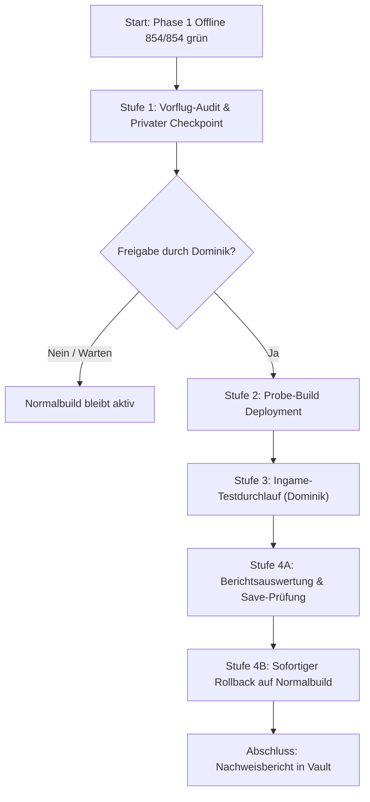

# TownHall: Übergangsplan zur Live-Save-Probe (Phase 1)

Stand: 2026-11-06. **Begrenzte Ingame-Probe bestanden, Normalbuild wiederhergestellt.**
Kandidat `38bd7da3…` bestand auf `TownHallTest / SaveGame_2` am 6. November
um 09:56:01 CET (08:56:01 UTC) genau einen eigenen synchronen
`ISaveable.Save`-Aufruf ohne Dateischreiben, mit bestätigter Completion und
eigenem Rückbau. Alle 39 nativen Testdateien gegen den frischen Checkpoint
bytegleich; anschließend Normalbuild `614b81fd…` / PDB `8126ae65…` wiederhergestellt.
[Laufzeitbeleg](evidence/business-save-live-success-20261106/observation.json),
[Save-Abgleich](evidence/business-save-live-success-20261106/save-verification.json),
[Rollback](evidence/business-save-live-success-20261106/rollback-verification.json).

Der vorausgehende Offline-Stand bestand 884/884 Tests und vier No-Deploy-Builds.
Die frühere Probe `3ffbc248…` blockierte um 08:41 UTC im Preflight; darauf folgten
die Getter-/Cleanup-Korrektur und das Deployment um 08:48:53 UTC.
[Installation vor dem erfolgreichen Lauf](evidence/business-save-fixed-deployment-20261106/deployment-verification.json),
[vorheriger Fehllauf](evidence/business-save-fixed-deployment-20261106/previous-live-report.json).
`NativeSaveWriteAllowed=false` bleibt bestehen. Vollständiger `SaveManager.Save`,
Persistenz/Reload, Kauf, Geldwäsche und Weltwechsel-/Last-Use-Vertrag sind nicht
nachgewiesen; Phase 1 bleibt offen.
[Korrektur, technische Teilabnahme und Grenzen](business-manager-save-probe.md).

Die folgenden Ausgangswerte und Stufen 1–4 beschreiben den ersten Testkandidaten:
Die Offline-Schritte 1 bis 3 von Phase 1 des [Fertigstellungsplans](business-completion-plan.md)
sind vollständig umgesetzt, mit 854/854 bestandenen Tests verifiziert und unabhängig
auditiert. Dieser Plan regelt den Übergang von der reinen Offline-Verifikation zu einer
begrenzten, schreibfreien Ingame-Probe im dedizierten Testspielstand.

> [!IMPORTANT]
> **Sicherheitsgrenze:** Dieser Übergangsplan führt ohne ausdrückliche Bestätigung durch
> Dominik **weder ein weiteres Deployment noch einen Spielstart** durch. Nach dem
> abgeschlossenen Testlauf ist der Normalbuild ohne Business-Proben installiert.

---

## 1. Ausgangslage und verifizierter Stand

| Komponente | Offline-Stand (2026-11-06) | Verifikationsstatus |
|---|---|---|
| **Schritt 1: ISaveable-Inventar** | 23-Slot-Vertragsinventar, Vor-Konstruktions-Armierung, 15 gebundene Vtable-Slots | 846 Tests grün, Coder & Verifier akzeptiert |
| **Schritt 2: Non-IO-Save-Pfad** | 16. Slot `ShouldSaveUnderFolder = false`, `IBusinessSavePort` auf `NativeSubtypePort` | 850 Tests grün, Coder & Verifier akzeptiert |
| **Schritt 3: Trial-Verknüpfung** | `BusinessSubtypeTrial.Run` führt No-IO Save-Trial aus, atomare CAS-Frame-Progression | 854 Tests grün, Coder & Verifier akzeptiert |
| **Aktive Spiel-Installation** | Normalbuild `614b81fd…` (ohne Proben) | Unverändert, verifiziert am 2026-11-06 |
| **Save-Sicherheitsgrenze** | `NativeSaveWriteAllowed = false` | Streng fail-closed |

Die Offline-Arbeit schließt Verzeichnisanlagen (`GetContainerFolder`) sowie rekursive
Datei- und Ordnerlöschschleifen im nativen `CompleteSave` (`0x582F00`) deterministisch
aus. Die Save-Probe führt über ein leeres `GetSaveString()` einen synchronen Tail-Jump
zu `CompleteSave("", false)` und `SaveManager.CompleteSaveable(this)` aus und bereinigt
ihre Registrierung anschließend vollständig aus `Saveables` und `CompletedSaveables`.

---

## 2. Verbindliche Isolations- und Sicherheitsgrenzen

1. **Ausschließliches Testziel: `TownHallTest / SaveGame_2`**
   - Pfad: `AppData/LocalLow/TVGS/Schedule I/Saves/76561199109519851/SaveGame_2`
   - Bestätigte Organisation in `Game.json`: `"TownHallTest"`
   - Gespeicherte Version: `0.4.7f12`
   - `ConstructionGate.Check` erzwingt diese Identität. Jeder Aufruf in einer anderen
     Welt bricht sofort ab (`skipped / wrong-slot`), ohne Portzugriff oder Registrierung.
2. **Strikter Schutz von Slot 1 (`Dominik / SaveGame_1`)**
   - Slot 1 ist der persönliche Spielstand von Dominik.
   - Slot 1 darf **unter keinen Umständen** mit einer aktiven Proben-DLL geladen werden.
   - Der Agent greift niemals auf Slot 1 zu.
3. **Steam Cloud: Bestätigt deaktiviert**
   - Lokaler Status: `CloudEnabled = 0` in `sharedconfig.vdf`.
   - Verhindert ungewollten Remote-Sync oder Überschreiben von Spielständen.
4. **Kein Spielstart durch den Agenten**
   - Der Agent startet die `Schedule I.exe` niemals selbst und setzt niemals `DOTNET_ROOT`.
   - Dominik startet und steuert das Spiel ausschließlich regulär über Steam.
5. **Privater Checkpoint vor jedem Deployment**
   - Vor dem Austausch von DLL/PDB wird ein vollständiger privater Zeitstempel-Checkpoint
     des Testspielstands (`SaveGame_2`) und von `UserData/TownHallInterior/` angelegt.
   - Hashes aller 39 nativen Dateien werden vor und nach der Probe verglichen.
6. **Sofortiger Rollback-Pfad**
   - Unmittelbar nach Abschluss der Ingame-Beobachtung wird der Normalbuild `614b81fd…`
     wiederhergestellt. Die Proben-DLL verbleibt nicht im Spielverzeichnis.

---

## 3. Binäridentitäten

### Rollback-Baseline: Normalbuild (aktuell im Spiel)
- **Verwendungszweck:** Rollback-Ziel vor und unmittelbar nach dem Test.
- **Konfiguration:** `Release` (ohne Proben-Defines, reiner Innenraum).
- **Dateien und Prüfsummen:**
  - `Mods/TownHallInterior.dll`:
    `614B81FD584040D4CEBE7A18929BCA09EABAE478A6487EC6D846EA01D6062003`
  - `UserData/TownHallInterior/TownHallInterior.pdb`:
    `8126AE65F5C12F6E8261AF0A1734E622D8C0AB5522A91E6653C7B1FFD7D8C497`
  - `UserData/TownHallInterior/mod.json`:
    `65938002B7273EF77DEDBADF9092A186E6742F1E40FE404EF91576D3E4F81660`

### Test-Kandidat: Manager- / Save-Probe
- **Verwendungszweck:** Begrenzter Einzeldurchlauf im Testslot `TownHallTest / SaveGame_2`.
- **Konfiguration:** `Release` mit `-p:S1TownHallBusinessManager=true`.
- **Defines:** `TOWNHALL_BUSINESS_PROBE;TOWNHALL_BUSINESS_SUBTYPE;TOWNHALL_BUSINESS_MANAGER`.
- **Dateien und Prüfsummen:**
  - `TownHallInterior.dll`:
    `F11DBF509ACE835C2E6BC2671EA9CEEE33134E9A699108881A294010CA3983F9`
  - `TownHallInterior.pdb`:
    `28923C3E84DE23731B0127758B22590AD49546B126370CE13A5610E033CA0C5C`

---

## 4. Schrittweiser Übergangsablauf

Mermaid-Übersicht des Ablaufs:

### Stufe 1: Vorflug-Audit & Privater Checkpoint (Agent)
1. **Prozesskontrolle:** Sicherstellen, dass `Schedule I` nicht läuft.
2. **Cloud-Prüfung:** Bestätigen, dass `CloudEnabled=0` aktiv ist.
3. **Checkpoint anlegen:**
   - 39 native Dateien von `SaveGame_2` nach `.backups/townhall-launch-prep/<id>/native/SaveGame_2/` kopieren.
   - `UserData/TownHallInterior/` nach `.backups/townhall-launch-prep/<id>/UserData/` kopieren.
   - Aktuelle Normalbuild-Payload sichern.
   - `manifest.private.json` mit SHA-256 Prüfsummen erstellen und verifizieren.

### Stufe 2: Deployment des Testkandidaten (Agent, nach Freigabe)
1. Proben-DLL (`F11DBF50…`) nach `<GameDir>/Mods/TownHallInterior.dll` kopieren.
2. Proben-PDB (`28923C3E…`) nach `<GameDir>/UserData/TownHallInterior/TownHallInterior.pdb` kopieren.
3. Readback-Verifikation: SHA-256 Hashes der installierten Dateien abgleichen.

### Stufe 3: Ingame-Testprotokoll (Dominik)
1. **Spiel starten:** Schedule I regulär **über Steam** starten (nicht die EXE direkt).
2. **Spielstand laden:** Im Hauptmenü auf „Spiel laden“ gehen und ausdrücklich **`TownHallTest / Slot 2`** auswählen.
   > [!CAUTION]
   > Nicht blind auf „Fortsetzen“ klicken und niemals `Dominik / Slot 1` wählen!
3. **Warten im Raum:** Nach dem Erscheinen im Spiel einfach ca. 15–20 Sekunden ruhig im Raum stehen bleiben.
   - Der Mod wartet 6 Sekunden nach `OnLoadComplete`, bevor die Probe einmalig auslöst.
   - Keine Tastenbedienung, kein Handy, keine Speicher- oder Konsolenbefehle erforderlich.
4. **Beobachtung:**
   - In der MelonLoader-Konsole erscheint:
     `TownHall save probe restricted to TownHallTest / SaveGame_2; native writes blocked until the completion contract is verified.`
   - Nach ~6 Sekunden läuft die Save-Probe durch.
5. **Spiel beenden:** Über das Pausenmenü (Escape) das Spiel regulär beenden („Spiel beenden“ oder „Hauptmenü“ -> Schließen).

### Stufe 4: Auswertung & Sofortiger Rollback (Agent & Dominik)
1. **Berichtsanalyse:**
   - Auslesen der frischen Berichtsdatei unter `<GameDir>/UserData/TownHallInterior/BusinessManager/20261106T*.json`.
   - Verifizieren von:
     - `SaveCompletionContractVerified == true`
     - `Result.Status == "observed"` und `Result.Findings` leer
     - `Result.Save.Status == "observed"`
     - `SafeToDestroy == true`
     - `CompletionConfirmed == true`
2. **Integritätsprüfung des Spielstands:**
   - Erneutes Hashen aller 39 nativen Dateien in `SaveGame_2`.
   - Sicherstellen, dass weder `Businesses/` noch andere native Verzeichnisse gelöscht oder unerwünscht modifiziert wurden.
3. **Sofortiger Rollback:**
   - Wiederherstellen von `TownHallInterior.dll` (`614B81FD…`) und `TownHallInterior.pdb` (`8126AE65…`).
   - Readback-Verifikation, dass der Normalbuild wieder exakt hergestellt ist.
4. **Dokumentation & Protokoll:**
   - Festhalten der Ergebnisse im Vault (`log.md`, `projects/schedule1-mod-only.md`).

---

## 5. Bereitstellung für Dominik

Sobald Dominik die Freigabe erteilt („Ja, weiter“ / „Test ausführen“), wird Stufe 1 (Checkpoint)
und Stufe 2 (Deployment) automatisiert ausgeführt. Danach führt Dominik Stufe 3 im Spiel durch.

---

## 6. Durchgeführter Testlauf und Befunde (2026-11-06)

Auf Dominiks Bestätigung („ja“) wurden Stufen 1 bis 4 am 2026-11-06 ausgeführt:

1. **Stufe 1 (Checkpoint):** Privater Checkpoint `20261106T054537590245Z-9fbfdbeb`
   (39 native Dateien in `SaveGame_2`, 162 UserData-Dateien, Baseline-Payload)
   angelegt und verifiziert ([launch-checkpoint-before-20261106.json](evidence/launch-checkpoint-before-20261106.json)).
2. **Stufe 2 (Deployment):** Test-Kandidat (`F11DBF50…`, PDB `28923C3E…`)
   über `deploy-mod.ps1` bereitgestellt und damals per Readback verifiziert.
   Die [gleichnamige Deploymentquittung](evidence/launch-deployment-receipt-20261106.json)
   wurde später für `3ffbc248…` überschrieben und belegt diesen ersten Kandidaten
   nicht mehr; seine tatsächlich geladene DLL steht im folgenden Live-Rohbericht.
3. **Stufe 3 (Ingame-Lauf):** Dominik startete Schedule I über Steam, lud `TownHallTest / SaveGame_2`.
   Die Probe löste 6 Sekunden nach `OnLoadComplete` um 05:48:20 UTC aus und schrieb
   den Bericht `20261106T054820764Z.json` ([business-manager-live-save-probe-failed-20261106.json](evidence/business-manager-live-save-probe-failed-20261106.json)).
4. **Ergebnis & Befund:**
   - **Sicherer Fail-Closed-Abbruch:** Die Probe brach kontrolliert bei `Inspect()` mit
     `subtype-readback-invalid` ab (`OwnVirtualTargets = false`), bevor eine native
     SaveManager-Registrierung oder ein Save stattfand. Die eigene Typregistrierung
     war abgeschlossen. Der Versuch wurde verbraucht (`AttemptConsumed = true`),
     alle internen Objekte wurden sauber zerstört (`CleanupComplete = true`).
   - **Ursachenanalyse IL2CPP `METHOD_ATTRIBUTE_FINAL`:**
     In `NativeSubtypePort.Inspect()` ruft die Prüfung `il2cpp_object_get_virtual_method(_businessPointer, entry.Value)` auf.
     Im Unity-IL2CPP-C++-Runtime-Code gilt:
     `if (method->flags & METHOD_ATTRIBUTE_FINAL) return method;`
     Da `Property.get_ShouldSaveUnderFolder` als `virtual final` deklariert ist
     (`NativeMethodInfoPtr_get_ShouldSaveUnderFolder_Public_Virtual_Final_New_get_Boolean_0`),
     gibt die IL2CPP-Funktion `entry.Value` (die Basismethode) zurück, statt den
     tatsächlich in `own.VTable[22]` überschriebenen VTable-Eintrag der abgeleiteten
     Klasse zu inspizieren. Maschinencode in `GameAssembly.dll` ruft jedoch direkt
     `[rax + 0xB0]` (Slot 22) auf, wodurch die native Überschreibung zur Laufzeit
     wirksam ist.
   - **Begrenzter Save-Abgleich:** Alle 39 nativen Dateien in `SaveGame_2` blieben vorhanden;
     nur die regulären Autosave-Dateien (`Metadata.json`, `NPCs.json`, `Player.json`,
     `Time.json`, `Trash.json`) wurden durch den nachfolgenden Spiel-Autosave aktualisiert.
     Keine Verzeichnisanlagen, keine Löschungen. Slot 1 (`SaveGame_1`) wurde nicht berührt.
5. **Stufe 4 (Rollback):** Nach Beenden des Spiels wurde der Normalbuild (`614b81fd…`,
   PDB `8126ae65…`) sofort wiederhergestellt und verifiziert
   ([launch-checkpoint-after-20261106.json](evidence/launch-checkpoint-after-20261106.json)).

## 7. Erfolgreicher Folgelauf und Normalrollback (2026-11-06)

Nach der dokumentierten Getter-/Cleanup-Korrektur und Installation führte Dominik
den begrenzten Test mit `38bd7da3…` auf `TownHallTest / SaveGame_2` aus. Der Bericht
`20261106T085601025Z.json` vom 6. November, 08:56:01 UTC, meldet `observed` ohne
Findings, bestätigte Registrierung, einen Save-Versuch samt Rückkehr und Completion,
`SafeToDestroy=true` und bestätigten eigenen Rückbau. Eigene Saveables-Einträge
vor/nach dem Versuch 0, Start/Completion 0/0 → 1/1, 404 fremde Saveables mit gleichem
Fingerprint; Register und fremde VTables unverändert. `GetSaveString=1`,
`WriteData=1`, Getterzähler 8; die Callbackzähler blieben nach Cleanup unverändert.
[Unveränderter Rohbericht](evidence/business-save-live-success-20261106/live-report.json),
[Auswertung](evidence/business-save-live-success-20261106/observation.json).

Alle 39 nativen Dateien sind gegen den frischen Checkpoint bytegleich; keine
fehlenden/neuen Dateien. Leere Baseline-Verzeichnisse waren nicht inventarisiert.
Nach geschlossenem Spiel wurde um 10:02:17 CET (09:02:17 UTC) die Normal-DLL
`614b81fd…` mit PDB `8126ae65…` wiederhergestellt und unabhängig hashgeprüft.
Ein erneuter Laufzeittest des Normalbuilds wurde nicht ausgeführt.
[Dateivergleich](evidence/business-save-live-success-20261106/save-verification.json),
[Rollback](evidence/business-save-live-success-20261106/rollback-verification.json).

Diese technische Teilabnahme gilt nur für den eigenen synchronen No-IO-Pfad.
Die Marker 2694 → 2698 sind synthetische Lesefortschritte, keine vier beobachteten
Unity-Frames. Weder vollständiger `SaveManager.Save` noch Persistenz/Reload oder
Weltwechsel-/Last-Use-Sicherheit wurden damit geprüft. Native Schreibfreigabe
bleibt false und Phase 1 bleibt offen.

